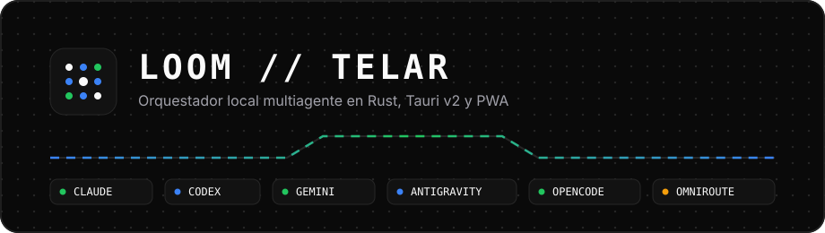

<div align="center">



# Loom (Telar)

**Orchestrate Claude Code, Codex, Gemini CLI, Antigravity, OpenCode, and OmniRoute from one local control plane.**

Rust daemon, MCP server, isolated Git worktrees, mobile PWA, and native bridge with [ClaudeHub](https://github.com/NormanSMA/ClaudeHub).

[Español](README.md) · **English** · [Português](README.pt-BR.md)

[](https://github.com/NormanSMA/Loom/actions/workflows/ci.yml)


<br />


</div>

## What it solves

- **Zero hangs or zombie processes:** Rust supervisor with closed `stdin`, JSONL idle heartbeats, Windows Job Objects, and Unix process groups.
- **Unified context without cache bloat:** compiles short capsules from Obsidian or local `.loom/` and indexes shared `SKILL.md` files.
- **Isolation and Quality Gates:** runs parallel tasks in separate `git worktree` directories and rejects out-of-scope diffs, `any`, emojis, or disguised SVG files.
- **Quota & privacy router:** `PrivacyGate` keeps confidential tasks off free providers and balances load using ClaudeHub quota snapshots.
- **Extensible registry:** add any CLI or OpenAI-compatible API via `~/.loom/providers/*.toml` without recompiling.
- **Safe remote access & offline standby:** binds `127.0.0.1:4320`, supports single-use QR pairing (120 s) over tunnels, and renders an interactive dot-matrix canvas offline.

## Try demo mode

```bash
git clone https://github.com/NormanSMA/Loom.git
cd Loom
pnpm install
pnpm web:build
cargo run -p loomd -- --demo --static-dir apps/web/dist
```

Open `http://127.0.0.1:4321`.

## Desktop app (Tauri v2)

Run the native desktop shell with `pnpm desktop:dev`. It adds a system tray menu (`Show Loom`, `Emergency stop`) and a native top floating island mirroring live agent state.

<details>
<summary><b>Install with an AI agent</b></summary>

Paste this prompt into Claude Code, Antigravity, Codex, or Gemini CLI:

````text
Install and verify Loom: https://github.com/NormanSMA/Loom
1. Clone the repository and enter the directory.
2. Check Rust (`rustc -V`), Node 24+ (`node -v`), and pnpm (`pnpm -v`).
3. Run `cargo test --workspace` and `pnpm install && pnpm web:test && pnpm web:build`.
4. Run `cargo run -p loom-cli -- doctor` and tell me which local tools are ready.
5. Start demo mode with `cargo run -p loomd -- --demo --static-dir apps/web/dist` at http://127.0.0.1:4321.
Read AGENTS.md before editing anything.
````

</details>

## License

[MIT](LICENSE) © 2026 Norman Smith Martínez Acevedo.
