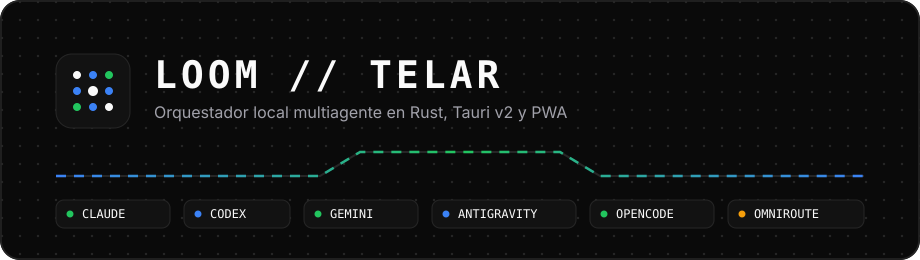

<div align="center">



# Loom (Telar)

**Orquesta Claude Code, Codex, Gemini CLI, Antigravity, OpenCode y OmniRoute desde un solo plano local.**

Daemon en Rust, servidor MCP, aislamiento por Git worktrees, PWA móvil y puente nativo con [ClaudeHub](https://github.com/NormanSMA/ClaudeHub).

**Español** · [English](README.en.md) · [Português](README.pt-BR.md)

[](https://github.com/NormanSMA/Loom/actions/workflows/ci.yml)


<br />


</div>

## Qué resuelve

- **Cero cuelgues y procesos zombis:** supervisor en Rust con cierre de `stdin`, timeouts por latido JSONL, Windows Job Objects y grupos de procesos Unix.
- **Contexto unificado sin inflar caché:** compila cápsulas cortas desde tu bóveda Obsidian o `.loom/` local e indexa `SKILL.md` compartidas.
- **Aislamiento y Quality Gates:** corre tareas paralelas en `git worktree` separados y bloquea `any`, emojis, rutas fuera de alcance y SVGs disfrazados de PNG.
- **Enrutador por cuota y privacidad:** `PrivacyGate` impide enviar código confidencial a modelos gratuitos y desvía carga usando las cuotas de ClaudeHub.
- **Extensible:** añade cualquier CLI o API OpenAI-compatible en `~/.loom/providers/*.toml` sin recompilar.
- **Acceso remoto seguro y modo offline:** escucha en `127.0.0.1:4320`, soporta emparejamiento QR efímero (120 s) por túnel y muestra un lienzo interactivo en reposo cuando la PC está apagada.

## Pruébalo en modo demo

```bash
git clone https://github.com/NormanSMA/Loom.git
cd Loom
pnpm install
pnpm web:build
cargo run -p loomd -- --demo --static-dir apps/web/dist
```

Abre `http://127.0.0.1:4321`.

## Aplicación de escritorio (Tauri v2) y Android

- **Escritorio (`Tauri v2`)**: ejecuta `pnpm desktop:dev`. Incluye bandeja del sistema (`Mostrar Loom`, `Parada total`), notificaciones, efectos de sonido configurables e isla flotante superior.
- **Android (`apps/android`)**: cliente nativo Kotlin (`dev.nsma.loom`) con puente de sonido PCM y notificaciones locales. Conecta tu equipo vía USB (`pnpm android:install`) o apunta a tu túnel HTTPS en Ajustes.
- **Landing oficial**: [loom.nsma.dev](https://loom.nsma.dev) ([NormanSMA/loom-web](https://github.com/NormanSMA/loom-web)).

## Comandos rápidos

```bash
cargo run -p loom-cli -- doctor
cargo run -p loom-cli -- providers list
cargo run -p loom-cli -- skills list
cargo run -p loom-cli -- route --role implementer --sensitivity confidential
cargo run -p loom-cli -- capsule --repo . --objective "Auditar ruta"
```

<details>
<summary><b>Instalar con una IA</b></summary>

Pega este bloque en Claude Code, Antigravity, Codex o Gemini CLI:

````text
Instala y verifica Loom (Telar): https://github.com/NormanSMA/Loom
1. Clona el repositorio y entra en la carpeta.
2. Verifica Rust (`rustc -V`), Node 24+ (`node -v`) y pnpm (`pnpm -v`).
3. Ejecuta `cargo test --workspace` y `pnpm install && pnpm web:test && pnpm web:build`.
4. Ejecuta `cargo run -p loom-cli -- doctor` y repórtame qué herramientas están activas.
5. Inicia el modo demo con `cargo run -p loomd -- --demo --static-dir apps/web/dist` en http://127.0.0.1:4321.
6. Si quiero conectar Antigravity o Claude Code, regístramelo apuntando a `loom-mcp` sin copiar claves en archivos rastreados.
Lee AGENTS.md antes de hacer cambios.
````

</details>

## Documentación

| Archivo | Uso |
|---|---|
| [AGENTS.md](AGENTS.md) | Comandos y reglas para agentes de IA. |
| [CONTRIBUTING.md](CONTRIBUTING.md) | Flujo de Issues, PRs y verificaciones. |
| [SECURITY.md](SECURITY.md) | Guardia `Host`, QR efímero y `PrivacyGate`. |

## Licencia

[MIT](LICENSE) © 2026 Norman Smith Martínez Acevedo.
