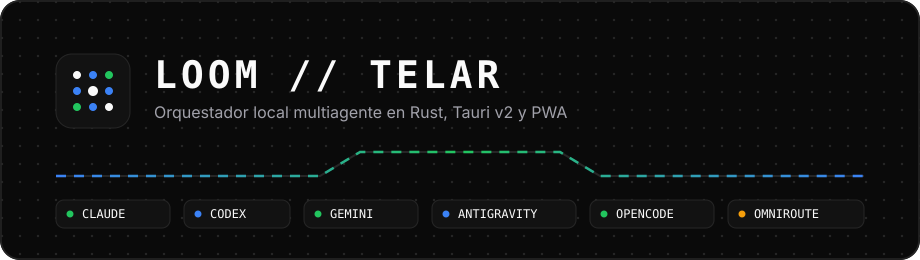

<div align="center">



# Loom (Telar)

**Orquestre Claude Code, Codex, Gemini CLI, Antigravity, OpenCode e OmniRoute em um único painel local.**

Daemon em Rust, servidor MCP, Git worktrees isolados, PWA móvel e integração nativa com o [ClaudeHub](https://github.com/NormanSMA/ClaudeHub).

[Español](README.md) · [English](README.en.md) · **Português**

[](https://github.com/NormanSMA/Loom/actions/workflows/ci.yml)


<br />


</div>

## O que resolve

- **Sem travamentos nem processos zumbis:** supervisor em Rust com fechamento de `stdin`, timeout JSONL, Windows Job Objects e grupos de processos Unix.
- **Contexto unificado sem inflar cache:** compila cápsulas curtas do Obsidian ou `.loom/` local e indexa `SKILL.md` compartilhadas.
- **Isolamento e Quality Gates:** executa tarefas em paralelo em `git worktree` separados e bloqueia `any`, emojis, arquivos fora do escopo e SVGs disfarçados.
- **Roteador por cota e privacidade:** `PrivacyGate` impede o envio de código confidencial para modelos gratuitos.
- **Extensível:** adicione novos CLIs ou APIs compatíveis com OpenAI em `~/.loom/providers/*.toml`.
- **Acesso remoto seguro e modo offline:** escuta em `127.0.0.1:4320`, pareamento QR de uso único (120 s) e tela interativa em repouso quando o PC estiver desligado.

## Teste em modo demo

```bash
git clone https://github.com/NormanSMA/Loom.git
cd Loom
pnpm install
pnpm web:build
cargo run -p loomd -- --demo --static-dir apps/web/dist
```

Abra `http://127.0.0.1:4321`.

## Aplicativo de desktop (Tauri v2)

Execute o aplicativo nativo com `pnpm desktop:dev`. Inclui ícone na bandeja do sistema (`Mostrar Loom`, `Parada total`) e uma ilha flutuante superior nativa para acompanhar os agentes em tempo real.

<details>
<summary><b>Instalar com uma IA</b></summary>

Cole este bloco no Claude Code, Antigravity, Codex ou Gemini CLI:

````text
Instale e verifique o Loom: https://github.com/NormanSMA/Loom
1. Clone o repositório e entre na pasta.
2. Verifique Rust (`rustc -V`), Node 24+ (`node -v`) e pnpm (`pnpm -v`).
3. Execute `cargo test --workspace` e `pnpm install && pnpm web:test && pnpm web:build`.
4. Execute `cargo run -p loom-cli -- doctor` e informe quais ferramentas estão ativas.
5. Inicie o modo demo com `cargo run -p loomd -- --demo --static-dir apps/web/dist` em http://127.0.0.1:4321.
Leia AGENTS.md antes de fazer alterações.
````

</details>

## Licença

[MIT](LICENSE) © 2026 Norman Smith Martínez Acevedo.
